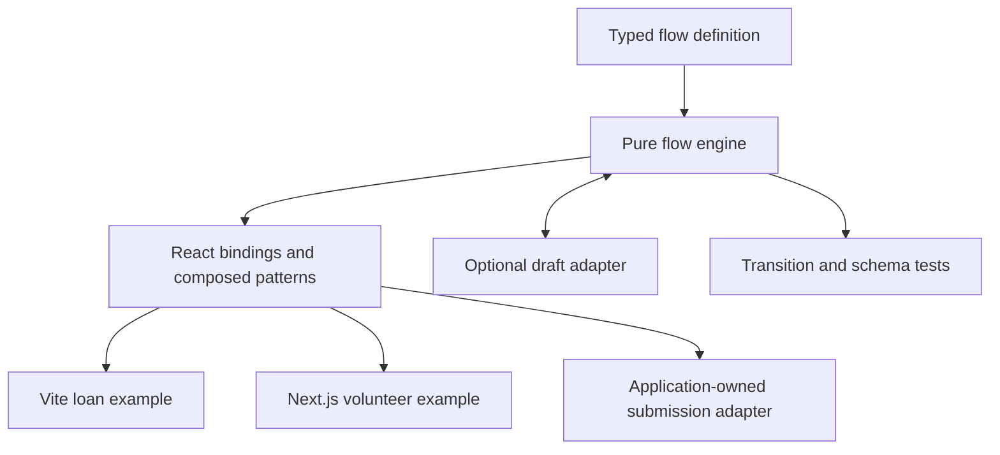

# FormPath — accessible conditional intake flows for React

Status: proposed implementation · Priority: second · Effort: 100–145 focused hours.

Read [shared engineering standards](ENGINEERING.md) and [research](RESEARCH.md). This plan includes a reusable package, documentation playground and two realistic consuming applications.

## 1. Problem and audience

Small community organisations repeatedly build intake forms for equipment loans, event volunteers and repair services. Developers often assemble field libraries successfully but lose the interactions between branching, validation, back navigation, error summaries, saved drafts and a final check-answers page. A user changes an earlier answer and stale hidden answers are submitted, or an error appears without focus moving to it.

FormPath supplies a typed, accessible flow layer above ordinary React fields. Its useful deliverable is an installable toolkit and a working community equipment-loan intake example, plus a repair-event volunteer application demonstrating reuse. It is not a new general-purpose input library or visual no-code form builder.

The [GOV.UK validation](https://design-system.service.gov.uk/patterns/validation/) and [check-answers](https://design-system.service.gov.uk/patterns/check-answers/) patterns document established user needs. [React Hook Form](https://react-hook-form.com/) and existing accessible primitives already handle important lower-level concerns; FormPath should compose them rather than reimplement their internals.

### Discovery and adoption gate

Interview two frontend developers who maintain conditional forms and three people who complete such forms. Reproduce an actual failure with a synthetic form. Ask a developer to build the same three-step flow using their current stack. Proceed if the toolkit removes meaningful repeated flow/error/review work without restricting necessary customization. If an existing library solves the same workflow well, contribute the missing pattern there or distribute FormPath as tested recipes rather than a new dependency.

Pilot goals: a developer can integrate a three-step flow in under one hour using only documentation; users can correct a review-page answer without losing unrelated work; keyboard and screen-reader testing finds no blocking path. These goals require actual trials before becoming claims.

## 2. Product scope

### First consuming flow: equipment loan request

Select equipment → choose individual or organisation → conditionally supply organisation details → requested dates → review answers → submit to a demo adapter → receipt. Use fictitious data. No payment, document upload or collection of identity documents.

### Second consuming flow: volunteer application

Select a repair-event role → role-specific skills/questions → availability → review → demo submission. Distinct layout and branding prove the API does not bake in the first app's assumptions.

### V1 capabilities

- Typed ordered step definitions, stable field IDs, conditional visibility and field-level/step-level validation.
- Native accessible field semantics composed with React Hook Form; reusable StepHeading, ErrorSummary, ProgressList, ReviewAnswers, SaveStatus and SubmissionReceipt components.
- Previous/next navigation, direct return from review to an answer, safe recovery of invalid deep links and browser-back behavior.
- Explicit policy for answers that become hidden: retain in the local draft with a notice, exclude from active validation and final payload. Reappear if their branch becomes active again.
- Opt-in same-device draft adapter; schema version and migration result visible. Memory-only by default; saved-draft availability never implied automatically.
- Submission adapter with `idle`, `submitting`, `succeeded`, `failed`, and `unknown` states; retry using the same idempotency key after a timeout.
- Translation dictionary with English and reviewed Sinhala example strings; locale-ready dates/numbers, RTL test fixture and long-label tests. Do not publish machine translation as reviewed human translation.
- Token-based styling and an unstyled/headless option. Support light/dark/forced-colors through documented tokens.
- SSR-safe React package tested inside a Next.js example and a Vite example. Only interactive regions are client components; no browser APIs during server render.

Deferred: visual drag-and-drop builder, arbitrary condition scripting, file upload, signatures, payments, survey analytics, rich text, collaborative authoring and a hosted submissions platform. A demo success message is never represented as a real organisation receiving an application.

## 3. User experience and design system

Human: a person completing an unfamiliar application on a phone, possibly interrupted. Main task: supply only relevant information and understand what happens next. Feel: calm, legible and predictable.

Domain: question, answer, branch, draft, correction, review, receipt. Color world: cream forms, dark blue ink, teal guidance, red corrections, grey progress marks. Signature: a review list that shows only active answers and returns users to the exact field, then back to review. Express it in error links, change links, progress, branch-change notice and receipt summary.

Avoid tiny wizard dots with hidden labels, modal-only validation and a wall of equally styled fields. Use clear step names and explain why information is requested. On mobile put the step heading and current task first; collapse optional progress detail without hiding position.

Proposed routes for examples: `/apply/:flowId/step/:stepId`, `/apply/:flowId/review`, `/apply/:flowId/receipt`. Do not put answers in the URL. On direct navigation, derive permitted steps from the current draft and return to the earliest required unanswered step with a message. Reload must not invent a successful submission.

Layout: 44rem reading/form column, optional 14rem progress rail above 1100px; 16px side padding on narrow screens; 24px between question groups; 8px label/help spacing. Body 16px with 1.5 line height; headings 24/32px. Controls at least 44px high as a usability choice. Use a humanist system stack for readable forms; self-host any optional font with its license. Palette starting points: `--form-paper: #FFFCF5`, `--answer-ink: #172C45`, `--continue: #006B63`, `--correction: #B42318`; verify contrast with actual styles. Border-led controls, surface tint for review groups and no decorative animation.

### Accessibility behavior contract

On failed next/submit, show and focus ErrorSummary; every entry links to its field. Associate inline errors and descriptions with stable IDs. On successful step navigation, focus the new heading, not an arbitrary first input. Restore field focus when returning through “Change”; return to review after confirming the edit. Announce saved/failed state sparingly in a polite live region. Group related radios with fieldset/legend. Do not validate on every keystroke by default; validate on attempted progression, then revalidate corrected fields without disrupting typing.

Progress is an ordered list with current/completed states, not a collection of custom ARIA tabs. Browser zoom must not clip errors. Conditional content should not move focus unexpectedly. Document tested screen-reader/browser combinations and remaining limitations.

## 4. Architecture and package boundaries



```text
packages/core/src/       types, conditions, transitions, payload projection
packages/react/src/      hooks, context and accessible flow patterns
packages/react/styles/   semantic tokens and optional default theme
apps/docs/               static docs/playground and Storybook links
examples/equipment-loan/ Vite consumer and mock submit adapter
examples/volunteer/      Next.js SSR/hydration consumer
fixtures/                invalid definitions and transition examples
tests/consumer/          install packed packages into clean fixtures
```

Use npm workspaces and Changesets. Core has no React/DOM dependency. React is a peer dependency, never bundled. Export named public entry points and declarations; keep styles explicit to avoid surprising side effects. Publish scoped names only after availability checks. Do not build a generic plugin system before two real integrations need it.

### Domain contracts

`FlowDefinition` includes id, version, ordered steps, fields and supported conditions. `DraftEnvelope` includes flowId, schemaVersion, answers, activeStepId, updatedAt and submissionAttempt metadata. `ValidationError` includes fieldId, translationKey and safe parameters. `SubmissionResult` is a tagged result: success(receiptId), validation(errors), retryable(code), or unknown(attemptId).

Conditions use a constrained AST: `equals`, `oneOf`, `all`, `any`, `not`, referencing declared field IDs. V1 conditions may reference only fields in earlier steps. Validate definitions at build/load time: unique IDs, valid references, no self/forward references, known operators, bounded nesting. This restriction prevents dependency cycles and makes navigation explainable. A computed field/function extension waits for demonstrated need.

Field values are a typed union: strings, booleans, string enums, string arrays and date-only ISO values; exact number parsing is application-owned. Date-only values must not be silently converted through UTC timestamps. Validation runs on active fields. Final payload is a projection of active answers only, validated again before passing to the submit adapter.

### Transition rules

| Event              | Rule                                                                                                               |
| ------------------ | ------------------------------------------------------------------------------------------------------------------ |
| `NEXT`             | Validate active fields for current step; move to next active step or review                                        |
| `BACK`             | Preserve draft and go to previous active step without requiring current validity                                   |
| `ANSWER_CHANGED`   | Recompute active steps; keep hidden draft values but exclude from payload; surface affected answers                |
| `EDIT_FROM_REVIEW` | Save return intent and exact target field; return to review after successful edit unless new required steps appear |
| `RESTORE_DRAFT`    | Validate envelope; migrate with supplied pure function or offer export/reset; never silently discard               |
| `SUBMIT`           | Validate entire active payload; create attempt key once; block concurrent submission                               |
| `TIMEOUT`          | Mark outcome unknown; retain attempt key; adapter must resolve/retry idempotently                                  |

Represent these as pure reducer transitions with effects performed in adapters. React Hook Form owns field interaction/dirty tracking; the flow reducer owns navigation/submission; persistence owns envelopes. Specify synchronization in a single binding hook, with tests for branch changes; avoid two independent competing sources of answers.

## 5. Persistence, SSR and backend integration

Default draft store is memory. Browser storage is opt-in per consumer and namespace per flow/version; store no sensitive answers in public examples. Provide clear-draft and JSON export/import. A quota or blocked-storage error leaves the form usable and says saving is unavailable. Handle multi-tab edits by comparing draft revision and asking which copy to keep; do not silently overwrite newer work.

Server render uses deterministic IDs and an empty/default snapshot. Client restoration occurs after hydration with an explicit restoring state; no reading `window` or IndexedDB during render. Test hydration without console warnings and field-ID mismatches. The Next.js demo proves integration, not a requirement to host Next.js for every user. Its dynamic server example runs locally/CI; a static browser demo and exported documentation are the free public deployment.

The toolkit cannot guarantee exactly-once submission by itself. Document the adapter contract: server validates independently, stores a unique attempt key with payload hash, returns the same receipt for a repeated key, and rejects reuse with a different payload. Use an in-memory deterministic demo adapter that can simulate accepted-but-response-lost; label it demonstration-only. Include a reference server fixture in tests, not a hosted database dependency. Consumers own authorization, CSRF protection where applicable, rate limiting and retention.

## 6. Test strategy and package acceptance

Core tests cover every transition and invalid condition graph. Property-style generated tests assert hidden fields never enter payloads, back/next preserves applicable answers, and editing a branch cannot skip newly required steps. Keep generated cases bounded/reproducible.

Component tests assert label/error relationships, focus targets, branch notices, repeat submission behavior and translation interpolation. Playwright covers loan and volunteer journeys, back/reload, restored drafts, timeout/retry and browser history. Include long German-style labels, Sinhala text and RTL fixtures even if only English is initially production-reviewed.

Consumer tests `npm pack` each package and install the tarball into Vite and Next.js fixtures. Verify ESM exports, TypeScript types, peer dependency resolution, CSS loading, SSR and hydration. Test supported stable React major versions only after explicitly declaring support; do not advertise an untested range.

Acceptance targets: flow core below 20 KiB gzip; React flow layer below 35 KiB gzip excluding React, field library and chosen primitives; simple keystrokes cause no unrelated step rerenders in profiler evidence; an example remains usable at 360px/400% zoom. Bundle budgets are initial targets measured after build, not current package sizes. Screenshot tests run in pinned browser/font conditions and require reviewed baseline updates.

Manual validation: keyboard-only full journey; VoiceOver/Safari and available NVDA/Firefox trials; screen-reader errors and review navigation; reduced motion/forced colors. Automated tests do not establish universal accessibility compliance.

## 7. Implementation sequence

| Milestone                 | Deliverables                                                                              | Exit criterion                                            | Hours |
| ------------------------- | ----------------------------------------------------------------------------------------- | --------------------------------------------------------- | ----- |
| M0 Research/API sketch    | Integration comparison; two flow schemas; API RFC; accessibility contracts                | At least one repeated problem worth extracting            | 8–12  |
| M1 Core alpha             | Definition validation; active-path projection; pure transitions; loan flow                | Complete memory-only loan path with branch edit           | 20–28 |
| M2 React patterns         | Field bindings; error summary; progress; review return; token theme; Storybook states     | Keyboard journey and component tests pass                 | 24–34 |
| M3 Durability/integration | Draft adapter/migration; unknown submission state; Next.js consumer; packed-package tests | Reload, retry and SSR consumer cases pass                 | 24–34 |
| M4 Public beta/v1         | Docs examples; API review; user trials; a11y report; bundle evidence; release workflow    | External developer integration trial and migration policy | 24–37 |

Dependencies: typed definition precedes UI; payload projection precedes submission; branching tests precede saved drafts; a second consumer precedes stable API; packed-package tests precede npm publication. Keep API pre-1.0 until both consumers reveal necessary changes.

## 8. Open-source and maintenance design

Six starter issues: (1) error-summary focus test, (2) long-label Storybook state, (3) reviewed translation contribution with glossary, (4) documentation of draft clearing, (5) sample equipment category field, (6) browser-back regression fixture. Document whether an issue changes a public API and requires a Changeset.

Accept pattern proposals with a user scenario, markup/keyboard contract and example. API changes need an RFC and migration example. Maintain a compatibility table, deprecation policy (one documented minor-cycle warning where feasible), release notes and sample upgrade PR. Security reports involving data exposure use the private reporting path; public bug reports must contain fictitious answers.

## 9. Deployment and senior-level evidence

Host static docs, Storybook and the Vite demo on Cloudflare Pages. Split deployments if the file count or build time approaches free limits. Publish core/react to npm through the shared trusted-publishing workflow. Keep the Next.js integration source runnable in CI/local development; do not promise SSR behavior from a static host.

Demo narrative: choose organisation, fill its details, switch to individual, inspect review to prove hidden answers are excluded, return to a field, reload an opt-in draft, simulate an unknown submission, then resolve it without duplication. Developer narrative: integrate the same package into a visually different example and explain where responsibilities stop.

Useful v1 gate: someone other than you can build a real permitted flow from the documentation, understand its submission boundary, and report an issue with a minimal reproduction. Your case study should cover API choices, accessibility decisions, migration strategy and what changed after that integration. Merely collecting reusable buttons does not satisfy this product's purpose.
